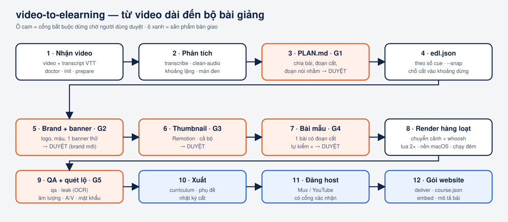

# Quy trình A → Z

Mỗi bước có một lệnh, một sản phẩm và (nếu có) một **cổng duyệt**: Claude dừng, đưa kết quả cho bạn, không đi tiếp khi chưa có "ok".

| # | Bước | Lệnh | Sản phẩm | Cổng |
|---|---|---|---|---|
| 0 | Kiểm tra môi trường | `v2e doctor` | bảng ✅/❌, hỏi trước khi cài | G0 |
| 1 | Nhận video | `v2e init` | thư mục dự án, `input/` | |
| 2 | Phân tích | `v2e prepare` · `transcribe` · `clean-audio` | khoảng lặng, khung hình, `work/cues.json`, `bymin.txt`, `flags.md`, audio sạch | |
| 3 | Lập kế hoạch | Claude đọc transcript (chia nhỏ cho nhiều tác tử nếu > 1000 câu) | `PLAN.md`: bài, đoạn cắt, bảng nói nhầm, thông tin nhạy cảm | **G1** |
| 4 | Dựng danh sách cắt | `v2e edl --snap` | `edl.json` theo **số cue**; chỗ cắt dời vào khoảng dừng | |
| 5 | Brand | `v2e thumbs --only X` | 1 banner thử với logo/màu của bạn | **G2** (brand mới) |
| 6 | Thumbnail | `v2e thumbs` | `out/thumb/*.png` + bảng tổng hợp | **G3** |
| 7 | Bài mẫu | `v2e render --sample` | 1 bài có đoạn cắt; tự kiểm khung hình tại chỗ nối, âm lượng, mở đầu = thumbnail | **G4** |
| 8 | Hàng loạt | `v2e render --all` | `out/final/*.mp4`, `out/cut-log.md` | |
| 9 | Nghiệm thu | `v2e qa` · `v2e leak` · `v2e export` | `qa-report.md`, `leak-report.md`, phụ đề, `curriculum.json` | **G5** |
| 10 | Đăng host (tuỳ chọn) | `v2e youtube` / skill `mux-publisher` | link player, ID, sổ đăng ký | xác nhận từng đợt |
| 11 | Gói website (tuỳ chọn) | `v2e deliver` | `course.json`, `lessons.csv`, mã embed, mô tả bài | |

## Luật cắt

- Cắt theo khoảng lặng **đo từ âm thanh**, không theo mốc thời gian của Whisper.
- Mỗi chỗ cắt = giảm tiếng + mờ hình + whoosh; ghi vào `out/cut-log.md` (số video, thời điểm, lý do).
- Hai chỗ cắt gần nhau dưới 6 giây được gộp lại.
- **Không có nhạc nền khi người nói đang nói.** Nhạc chỉ có ở 4 giây thumbnail mở đầu.

## Thông tin nhạy cảm

Cắt đúng khoảnh khắc người nói dán mật khẩu là **chưa đủ**: cửa sổ chat/ghi chú đó thường hiện lại ở nhiều đoạn khác.

1. Ghi vào PLAN mọi chuỗi nhạy cảm (tên đăng nhập, mật khẩu, khoá API).
2. Sau khi render: `v2e leak <dir> --terms "chuỗi1,chuỗi2"` quét OCR toàn bộ video thành phẩm.
3. Có ❌ thì cắt nguyên câu (cue) chứa cửa sổ đó, render lại bài, quét lại.

## Khi sửa sau bàn giao

Người dùng chỉ vào `out/cut-log.md` ("video 12, cắt lúc 07:23"). Chỉ render lại bài bị nhắc: `v2e edl --snap` → `v2e render --only X --force`. **Nếu đổi khoảng cắt thì thumbnail của bài đổi theo — dựng lại thumbnail và bài trước khi nghiệm thu**, nếu không phần mở đầu sẽ lệch thumbnail đã duyệt.
